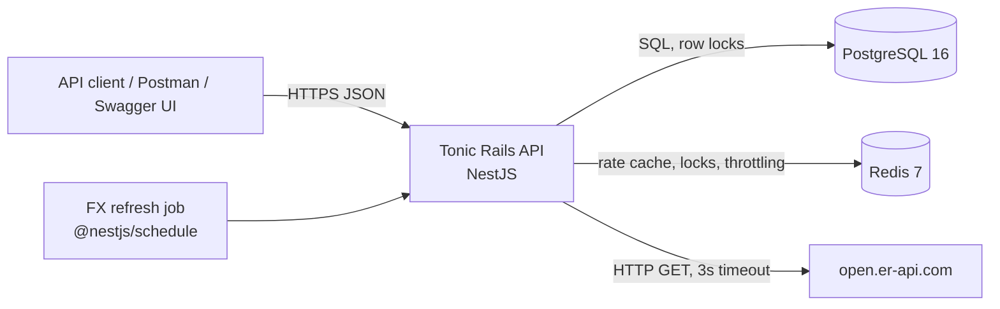
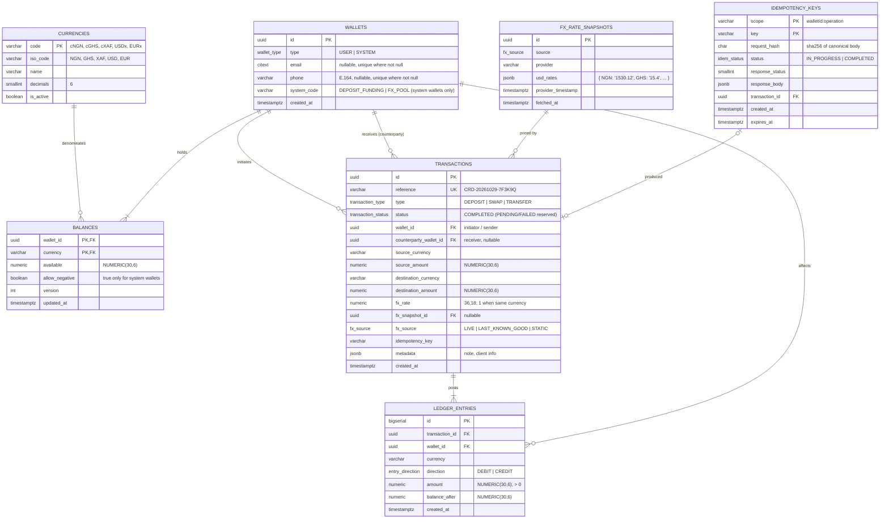

# Tonic Rails — Technical Design Document

> **Project:** Cardtonic Backend Assessment — _Operation Borderless_
> **Codename:** **Tonic Rails** (payment rails for moving stablecoins across borders)
> **Status:** v3: implemented (see §22 for as-built deviations)
> **Repository:** `tonic-rails-api`
> **Time budget:** 48 hours
> **Stack:** Node.js 22 LTS · TypeScript (strict) · NestJS 11 · PostgreSQL 16 · TypeORM · Redis 7 · Jest + Supertest · Yarn · Docker Compose

---

## Table of contents

1. [Goals and non-goals](#1-goals-and-non-goals)
2. [Requirements traceability](#2-requirements-traceability)
3. [Key engineering decisions](#3-key-engineering-decisions)
4. [Architecture](#4-architecture)
5. [Project structure](#5-project-structure)
6. [Data model](#6-data-model)
7. [Money precision](#7-money-precision)
8. [Ledger design (double-entry)](#8-ledger-design-double-entry)
9. [Concurrency control](#9-concurrency-control)
10. [Idempotency](#10-idempotency)
11. [FX rates: providers, caching, fallback](#11-fx-rates-providers-caching-fallback)
12. [API design](#12-api-design)
13. [Validation, errors and the response envelope](#13-validation-errors-and-the-response-envelope)
14. [Observability and operational concerns](#14-observability-and-operational-concerns)
15. [Configuration](#15-configuration)
16. [Runtime: Docker and Compose](#16-runtime-docker-and-compose)
17. [Testing strategy](#17-testing-strategy)
18. [Implementation stages](#18-implementation-stages)
19. [Risks and mitigations](#19-risks-and-mitigations)
20. [Assumptions, limitations, future work](#20-assumptions-limitations-future-work)
21. [Decisions log](#21-decisions-log)
22. [As built: deviations from this design](#22-as-built-deviations-from-this-design)

---

## 1. Goals and non-goals

### Goals

- A REST API for a **multi-currency stablecoin wallet sandbox** that supports cNGN, cGHS, cXAF, USDx and EURx.
- **Correct money handling.** Exact arithmetic, no negative balances, an auditable history, and each request processed exactly once.
- Ledger operations that hold up when **many requests run at once**: concurrent requests cannot double-spend.
- **FX that keeps working when the provider fails.** Live rates first, then a layered fallback, with every response saying where its rate came from and how old it is.
- **One command to run** (`docker compose up`) and **one command to test** (`yarn test`).
- A codebase that is easy to navigate and extend: a consistent module layout, swappable providers behind interfaces, and one place for each cross-cutting concern.

### Non-goals (stated explicitly in the README)

- Authentication and authorization (the brief says none is required; see §20 for what we would add).
- Real blockchain or custody integration. The stablecoins are ledger entries only.
- KYC/AML, limits by tier, sanctions screening.
- Fees and revenue (designed so they can be added later, see §8.5).
- A frontend.

---

## 2. Requirements traceability

Every line of the brief is mapped to a design element and a test, so nothing gets dropped.

| #   | Requirement (brief)                                                     | Design element                                                                          | Verified by                          |
| --- | ----------------------------------------------------------------------- | --------------------------------------------------------------------------------------- | ------------------------------------ |
| W1  | Create wallet with email **or** mobile number                           | `POST /v1/wallets`; Zod XOR schema; E.164 normalisation                                 | e2e `wallets.e2e-spec`               |
| W2  | Same email/number cannot create two wallets                             | Partial unique indexes on normalised `email` (citext) and `phone`; maps `23505` → `409` | e2e + race test (parallel creates)   |
| W3  | Balance per supported stablecoin                                        | `balances` row per (wallet, currency), created eagerly on wallet creation               | unit + e2e                           |
| W4  | All balances + total USD equivalent                                     | `GET /v1/wallets/:id/balances` valued using the current rate snapshot                   | e2e                                  |
| D1  | Deposit with currency + amount                                          | `POST /v1/wallets/:id/deposits`                                                         | e2e                                  |
| D2  | Balance updates immediately + transaction record                        | Single DB transaction: ledger entries + balance update + `transactions` row             | integration                          |
| S1  | Swap within the same wallet                                             | `POST /v1/wallets/:id/swaps`                                                            | e2e                                  |
| S2  | Live FX with fallback                                                   | `FxModule` provider chain (§11)                                                         | unit (provider failure matrix)       |
| S3  | Reject swaps that would go negative                                     | Conditional `UPDATE … WHERE available >= :amt` + `CHECK` constraint                     | e2e + concurrency test               |
| S4  | Never process the same request twice                                    | `Idempotency-Key` header + `idempotency_keys` table + unique index (§10)                | e2e replay + parallel duplicate test |
| T1  | Send to another wallet, same or different currency                      | `POST /v1/wallets/:id/transfers`                                                        | e2e                                  |
| T2  | Automatic conversion when currencies differ                             | Same conversion engine as swaps                                                         | unit + e2e                           |
| T3  | Record sender, receiver, source/dest amount + currency, rate, timestamp | Columns on `transactions` (§6)                                                          | e2e asserts payload                  |
| H1  | List transactions newest first, paginated, filter by type & currency    | `GET /v1/wallets/:id/transactions` with keyset pagination                               | e2e                                  |
| H2  | Fetch a transaction by id                                               | `GET /v1/transactions/:id`                                                              | e2e                                  |
| H3  | Current rates for all pairs, with last refresh time                     | `GET /v1/fx/rates` (20 pairs + `refreshedAt` + `source`)                                | e2e                                  |
| X1  | TS strict mode                                                          | `"strict": true` in tsconfig                                                            | `yarn build` in CI                   |
| X2  | Yarn, ESLint, Prettier                                                  | Yarn (classic or Berry, `nodeLinker: node-modules`)                                     | `yarn lint`                          |
| X3  | `docker compose up` starts everything; migrations run automatically     | Compose healthchecks + migrations run on boot                                           | manual + README                      |
| X4  | `yarn test` runs the full suite and passes                              | Jest projects: unit + e2e with Testcontainers                                           | CI                                   |
| X5  | OpenAPI/Swagger committed                                               | `docs/openapi.json` generated by script + served at `/docs`                             | script check                         |
| X6  | README sections                                                         | Checklist in Stage 9                                                                    | review                               |
| X7  | Clear commit history, conventional commits                              | commitlint + husky                                                                      | git log                              |

---

## 3. Key engineering decisions

| Decision                | Choice                                                                                                                       | Why                                                                                                                                                                                                                                                                                                                                                 |
| ----------------------- | ---------------------------------------------------------------------------------------------------------------------------- | --------------------------------------------------------------------------------------------------------------------------------------------------------------------------------------------------------------------------------------------------------------------------------------------------------------------------------------------------- |
| Framework               | **NestJS 11**                                                                                                                | Opinionated module structure and DI. DI makes the swappable FX provider and test overrides simple.                                                                                                                                                                                                                                                  |
| Database                | **PostgreSQL 16**                                                                                                            | ACID multi-row transactions, `SELECT … FOR UPDATE` row locks, `CHECK` constraints that enforce non-negative balances in the database, exact `NUMERIC`, partial unique indexes and `citext`. A ledger is relational data that needs strict consistency. A document store would make the database invariants and atomic multi-account updates harder. |
| ORM                     | **TypeORM 0.3**                                                                                                              | First-class NestJS integration and migrations. Money-path queries use the `EntityManager` / QueryBuilder directly, so we control locking.                                                                                                                                                                                                                                                |
| Money representation    | **`NUMERIC(30,6)`** in Postgres (6 dp, on-chain stablecoin convention), **Decimal.js** in TS, decimal strings on the wire    | No floating point anywhere on the money path. One scale from database to response. See §7.                                                                                                                                                                                                                                                          |
| Money math              | **decimal.js** for all amount and FX arithmetic, explicit `ROUND_DOWN`                                                       | Exact decimal arithmetic. The rounding policy is deterministic and documented.                                                                                                                                                                                                                                                                      |
| Bookkeeping             | **Double-entry ledger** with system accounts                                                                                 | Every movement balances to zero, so money cannot appear or vanish. It can be audited and reconciled.                                                                                                                                                                                                                                                |
| Concurrency             | `READ COMMITTED` + pessimistic row locks in a deterministic order + conditional update + DB `CHECK`                          | Defence in depth. Deadlock-free by construction, with bounded retry on `40P01`/`40001`.                                                                                                                                                                                                                                                             |
| Idempotency             | `Idempotency-Key` header (Stripe-style), persisted in Postgres **in the same transaction** as the money movement             | Exactly-once semantics that survive crashes. Redis-only idempotency is not atomic with the ledger write.                                                                                                                                                                                                                                            |
| FX source               | **open.er-api.com** (free, no key, includes NGN/GHS/XAF/EUR) → Redis cache → last-known-good in Postgres → static seed table | Live rates preferred (per the brief), and the service keeps working through each layer of failure.                                                                                                                                                                                                                                                  |
| Redis                   | **Yes, narrowly.** FX rate cache shared across replicas and a lock for the refresh job                       | Earns its place: N API replicas must not each call the FX provider. If Redis is unavailable, every call degrades to a cache miss and the app falls back to Postgres.                                                                                                                                                                                                                        |
| Queue (BullMQ/RabbitMQ) | **No**                                                                                                                       | Every operation is synchronous and in-process. A queue adds failure modes without benefit here. It is mentioned under future work (webhooks/outbox).                                                                                                                                                                                                |
| Validation              | **Zod via `nestjs-zod`**                                                                                                     | One schema gives runtime validation, TS types and OpenAPI docs.                                                                                                                                                                                                                                                                                     |
| Pagination              | **Keyset (cursor)** on `(created_at, id)`                                                                                    | Stable under concurrent inserts and O(log n). Offset pagination drifts and slows down.                                                                                                                                                                                                                                                              |
| Logging                 | **nestjs-pino** with request IDs                                                                                             | Structured JSON logs and correlation per request. No `console.log` in application code.                                                                                                                                                                                                                                                             |

### Engineering standards

| Area           | Standard                                                                                       | Reason                                                                                                                        |
| -------------- | ---------------------------------------------------------------------------------------------- | ----------------------------------------------------------------------------------------------------------------------------- |
| Type safety    | `"strict": true` (including `strictNullChecks`, `noImplicitAny`)                               | Required by the brief. Null-safety also matters on money paths.                                                               |
| Package manager | Yarn, `--frozen-lockfile` in Docker and CI                                                   | Required by the brief. Reproducible installs.                                                                                 |
| Configuration  | Joi validation in `EnvService` at boot **plus** a typed `AppConfig` read through `ConfigService` | Config is validated once, typed, and injectable, so tests can override it. No scattered `process.env` reads.                |
| Errors         | `DomainException` hierarchy with machine-readable `code`, plus one global `AllExceptionsFilter` | Clients can branch on `INSUFFICIENT_FUNDS` and similar codes. Postgres errors (`23505`, `23514`) map to proper 4xx responses. |
| Schema         | Never `synchronize`. Migrations run automatically on boot (`migrationsRun: true`)              | Reproducible schema and safe deploys.                                                                                         |
| Cache          | `ioredis` behind a small `RedisService`                                                        | Needs SET NX locks as well as get/set; never throws on outage.                                                                                      |
| Health         | `@nestjs/terminus` (`/health/live`, `/health/ready` checking DB + Redis)                       | Real readiness probes for Compose healthchecks.                                                                               |

---

## 4. Architecture

### 4.1 Context



### 4.2 Layers inside the API

```
Controller   – HTTP only: parse/validate (Zod), map to service call, wrap { message, data }
   │
Service      – Use-case orchestration: DepositService, SwapService, TransferService …
   │           Owns the DB transaction boundary (one use case = one transaction).
   │
LedgerService – The ONLY code allowed to change balances. Takes a balanced set of postings,
   │            locks rows in deterministic order, applies, writes ledger entries.
   │
Repositories – AbstractRepository base class; money methods take an EntityManager.
   │
PostgreSQL   – Final guard: CHECK (available >= 0), FKs, unique indexes.
```

**Rule:** no service other than `LedgerService` writes to `balances` or `ledger_entries`. That rule plus the DB constraints makes the invariants hold everywhere.

### 4.3 Swap request lifecycle

```mermaid
sequenceDiagram
  autonumber
  participant C as Client
  participant T as TransactionService
  participant I as IdempotencyService
  participant FX as FxService
  participant L as LedgerService
  participant DB as Postgres

  C->>T: POST /api/v1/wallets/:id/swaps (Idempotency-Key: k1)
  T->>I: execute(ctx, prepare, work)
  I->>DB: SELECT idempotency_keys WHERE scope,key
  alt completed, same request hash
    I-->>C: replay stored status + body (Idempotent-Replayed: true)
  else hash mismatch
    I-->>C: 422 IDEMPOTENCY_KEY_REUSED
  else new
    I->>T: prepare(): wallet exists, quote
    T->>FX: getSnapshot()  (memo → Redis → live → LKG → static)
    I->>DB: BEGIN; SET LOCAL lock_timeout = '5s'
    I->>DB: INSERT idempotency_keys … ON CONFLICT DO NOTHING (claims key)
    I->>T: work(manager)
    T->>DB: INSERT transactions (amounts, rate, snapshot id)
    T->>L: post(transactionId, postings[])
    L->>DB: SELECT … FROM balances … ORDER BY wallet_id, currency FOR UPDATE (user rows)
    L->>DB: UPDATE balances SET available = available - x WHERE … AND available >= x
    L->>DB: INSERT ledger_entries (balanced per currency)
    I->>DB: UPDATE idempotency_keys SET status=COMPLETED, response
    I->>DB: COMMIT
    I-->>C: 201 { message, data: transaction }
  end
```

---

## 5. Project structure

`module/` holds features, `shared/config` wires infrastructure, `shared/global` holds cross-cutting types/schemas/errors/model, and `shared/util` holds provider implementations.

```
tonic-rails-api/
├── src/
│   ├── main.ts                          # bootstrap: pino logger, setupApp, swagger, listen
│   ├── app.module.ts                    # global pipe (Zod), guard (throttler), filter
│   ├── bootstrap/setup-app.ts           # helmet, CORS, body limit, /api prefix, URI versioning, OpenAPI builder
│   ├── migrations/                      # hand-written schema + reference-data seed
│   ├── module/
│   │   ├── wallet/                      # create wallet, get wallet, balances (+ USD total)
│   │   ├── transaction/                 # deposits, swaps, transfers (TransactionService), history (TransactionQueryService)
│   │   │   ├── wallet-transaction.controller.ts   # /wallets/:id/{deposits,swaps,transfers,transactions}
│   │   │   ├── transaction.controller.ts          # /transactions/:id
│   │   │   └── transaction.presenter.ts           # entity → API view (masking, direction)
│   │   ├── ledger/                      # LedgerService + PostingBuilder; no controller
│   │   ├── idempotency/                 # IdempotencyService (claim/replay/record) + hourly purge
│   │   ├── fx/                          # FxService (resolution chain), FxRefreshJob, rates controller
│   │   └── health/                      # terminus live/ready
│   └── shared/
│       ├── config/
│       │   ├── env/          env.module.ts, env.service.ts (Joi schema), app-config.ts (typed)
│       │   ├── db/           db.module.ts, db.service.ts, data-source.ts, snake-naming.strategy.ts
│       │   ├── cache/        cache.module.ts, redis.service.ts   (ioredis; degrades to cache-miss)
│       │   └── fx/           fx-provider.module.ts, fx-provider.service.ts  ← env-selected provider
│       ├── global/
│       │   ├── constants/    currency, system (fixed system wallet ids), fx, common
│       │   ├── enums/        currency, wallet, transaction, fx, idempotency, error-code, message
│       │   ├── errors/       wallet/transaction/idempotency messages, ErrorMessage + ErrorStatus maps,
│       │   │                 domain.exception.ts, filters/all-exceptions.filter.ts
│       │   ├── interfaces/   fx-provider.interface.ts
│       │   ├── decorators/   idempotency-key.decorator.ts, uuid-param.pipe.ts
│       │   ├── model/
│       │   │   ├── entities/      currency, wallet, balance, wallet-transaction, ledger-entry, fx-rate-snapshot, idempotency-key
│       │   │   └── repositories/  abstract.repository.ts + one per entity
│       │   └── schemas/      common, wallet, transaction, fx (Zod) + dto/ (createZodDto classes)
│       └── util/
│           ├── money.util.ts             # Money (Decimal.js clone), parse/format, convertViaUsd, transformers
│           ├── open-er-api.util.ts       # IFxProvider: live
│           ├── static-fx.util.ts         # IFxProvider: fixed table
│           ├── db.util.ts                # queryRows, withTransactionRetry (40P01/40001)
│           ├── pg-error.util.ts          # SQLSTATE helpers
│           └── hash / cursor / identity / reference / circuit-breaker utils
├── scripts/generate-openapi.ts           # writes docs/openapi.json (Nest preview mode, no DB)
├── test/
│   ├── e2e/                 wallets, money-movement, idempotency, concurrency, history, fx, platform, ledger-invariants
│   └── utils/               global-setup (Testcontainers + migrations), test-app (factory, API helpers, ledger checks)
├── docs/
│   ├── TECHNICAL_DESIGN.md  (this file)
│   ├── openapi.json         (generated, committed)
│   └── tonic-rails.postman_collection.json (optional)
├── docker/
│   └── entrypoint.sh
├── Dockerfile
├── docker-compose.yml
├── .env.example
├── .eslintrc / eslint.config.mjs, .prettierrc, commitlint.config.js, .husky/
└── README.md
```

### 5.1 FX provider wiring (interface + injection token + env-selected implementation)

```ts
// shared/global/interfaces/fx-provider.interface.ts
export interface IFxProvider {
  readonly name: FxSourceEnum;
  /** USD-based rates for the requested ISO codes. Throws FxProviderError on failure. */
  fetchUsdRates(
    isoCodes: string[],
    signal?: AbortSignal,
  ): Promise<UsdRateSnapshot>;
}

// shared/config/fx/fx-provider.service.ts
export class FxProviderService {
  static providers() {
    const fxProviders = {
      openErApi: OpenErApiFxUtil,
      static: StaticFxUtil,
    };
    return [
      {
        provide: PRIMARY_FX_PROVIDER,
        useClass: fxProviders[process.env.FX_PROVIDER ?? "openErApi"],
      },
      { provide: FALLBACK_FX_PROVIDER, useClass: StaticFxUtil },
    ];
  }
}
```

`FxService` injects `@Inject(PRIMARY_FX_PROVIDER)` and `@Inject(FALLBACK_FX_PROVIDER)` and depends only on `IFxProvider`, never on a concrete class. Adding a second live provider (e.g. exchangerate.host) means one util class and one map entry.

### 5.2 Repository pattern

A generic `AbstractRepository<T>` (`getOneByColumn`, `getColumnCount`) is the base for every repository. It has one extra method so repositories work inside a transaction:

```ts
withManager(manager: EntityManager): Repository<TEntity> {
  return manager.getRepository(this.target);
}
```

---

## 6. Data model

### 6.1 ER diagram



### 6.2 Constraints and indexes (the database is the final guard)

```sql
-- wallets
CREATE EXTENSION IF NOT EXISTS citext;
ALTER TABLE wallets ADD CONSTRAINT chk_wallet_identity
  CHECK (type = 'SYSTEM' OR (email IS NOT NULL) <> (phone IS NOT NULL));   -- exactly one of email/phone
CREATE UNIQUE INDEX uq_wallets_email ON wallets (email) WHERE email IS NOT NULL;
CREATE UNIQUE INDEX uq_wallets_phone ON wallets (phone) WHERE phone IS NOT NULL;

-- balances
ALTER TABLE balances ADD CONSTRAINT chk_balance_non_negative
  CHECK (allow_negative OR available >= 0);

-- ledger_entries (append-only)
ALTER TABLE ledger_entries ADD CONSTRAINT chk_entry_amount_positive CHECK (amount > 0);
CREATE INDEX ix_ledger_wallet_created ON ledger_entries (wallet_id, created_at DESC, id DESC);
-- Revoke UPDATE/DELETE from the app role on ledger_entries (append-only at DB level).

-- transactions
ALTER TABLE transactions ADD CONSTRAINT chk_tx_amounts_positive
  CHECK (source_amount > 0 AND destination_amount > 0);
CREATE UNIQUE INDEX uq_tx_idempotency ON transactions (wallet_id, type, idempotency_key);
CREATE INDEX ix_tx_wallet_created       ON transactions (wallet_id, created_at DESC, id DESC);
CREATE INDEX ix_tx_counterparty_created ON transactions (counterparty_wallet_id, created_at DESC, id DESC)
  WHERE counterparty_wallet_id IS NOT NULL;
```

**Email or phone, not both?** The brief says "an email address **or** a mobile number". We accept exactly one and the `CHECK` enforces it. If both were allowed, one person could create two wallets by registering with each identifier separately. (This is listed in §21 for confirmation.)

### 6.3 Seeded reference data (inside migrations, so `docker compose up` gets it with no extra step)

- `currencies`: the 5 coins, `decimals = 6`.
- System wallets: `DEPOSIT_FUNDING` (the counter-account for simulated fiat on-ramp) and `FX_POOL` (the liquidity provider for swaps and cross-currency transfers), each with 5 balance rows, `allow_negative = true`.
- One `fx_rate_snapshots` row with `source = STATIC`, so the app has rates even before the first live fetch succeeds.

---

## 7. Money precision

### 7.1 Representation

**Decision:** every coin uses **6 decimal places** in storage, in calculations and on the wire, the same convention as USDC and USDT on-chain. These are stablecoins, not fiat, so 2-decimal fiat precision would be wrong for them. All arithmetic goes through **Decimal.js**. No JS `number` ever holds an amount.

| Layer       | Form                                                        | Example (9,999.999999 cNGN)           |
| ----------- | ----------------------------------------------------------- | ------------------------------------- |
| API input   | **Decimal string**, at most 6 dp                            | `"9999.999999"`, `"1500.5"`, `"1500"` |
| API output  | **Decimal string, trailing zeros trimmed** (at most 6 dp)   | `"9999.999999"`, `"1500.5"`, `"1500"` |
| Domain (TS) | `Decimal` (decimal.js)                                      | `new Decimal('9999.999999')`          |
| DB          | `NUMERIC(30,6)`                                             | `9999.999999`                         |
| FX rates    | `NUMERIC(36,18)` in DB, `Decimal` in TS, string on the wire | `"0.000653594771241830"`              |

- **One scale end to end:** the database, the domain and the API all use 6 dp. What the client sees is exactly what the ledger holds, so "send my whole balance" always works and statements always add up.
- **Why `NUMERIC(30,6)` and not `BIGINT` minor units:** Postgres `NUMERIC` is exact decimal, so the in-database arithmetic (`available - $amt`) is exact as well. It pairs naturally with Decimal.js, so we never convert between scaled integers and decimals. 24 integer digits remove any overflow concern. The performance cost of `NUMERIC` over `BIGINT` is negligible at this scale.
- **Decimal.js configuration:** one shared instance, `Decimal.clone({ precision: 40, rounding: Decimal.ROUND_DOWN })`, exported from `money.util.ts`. A lint rule (`no-restricted-syntax`) bans `parseFloat`, `Number(` and `toFixed` on money paths.
- **TypeORM transformer:** Postgres returns `NUMERIC` as a string. A column `ValueTransformer` converts between that string and `Decimal`, so entities only ever hold `Decimal`, and values are written back with `.toFixed(6)`.
- **Input validation:** JSON numbers are rejected for amounts, because `1500.1` as a JS number is already inexact before the request reaches us. The schema is `^(?!0+(\.0+)?$)\d{1,18}(\.\d{1,6})?$`: positive, at most 18 integer digits, at most 6 decimal places. A seventh decimal place returns `400`; we never round user input silently.
- **Output:** a single serialiser emits `Decimal#toDecimalPlaces(6).toFixed()`, which drops trailing zeros (`"10.500000"` → `"10.5"`), so every amount is the exact ledger value with no padding.

### 7.2 Conversion and rounding policy

```ts
destinationAmount = sourceAmount
  .mul(usdRate(dest))
  .div(usdRate(src))
  .toDecimalPlaces(6, Decimal.ROUND_DOWN);
```

- **Always round down the amount credited to the customer.** The platform never credits more value than it debited. The remainder below 0.000001 stays in `FX_POOL`, which keeps the ledger balanced. Real FX desks treat dust the same way.
- A conversion that rounds to `0` is rejected with `AMOUNT_TOO_SMALL` (e.g. swapping 0.000001 cNGN to USDx). Smaller amounts get a clear error message rather than a silent zero.
- `rate` is stored at 18 dp on the transaction **together with** a reference to the snapshot it came from, so the transaction can be recomputed exactly at audit time.
- **Cross rates are computed through USD:** `rate(A→B) = usd(B) / usd(A)`, where `usd(X)` is units of X per 1 USD. Rounding the rate first and then multiplying loses precision, so compute `amount × usd(B) / usd(A)` as one Decimal expression and round only once, at the end.

### 7.3 Total USD equivalent

`totalUsd = Σ round_down(balance_i × rate(i→USDx), 6)`. The response returns the total and the per-currency `usdValue` (both at up to 6 dp), plus `ratesAsOf` and `rateSource`, so clients can see that the valuation is indicative and how fresh it is.

---

## 8. Ledger design (double-entry)

### 8.1 Why double-entry

Storing a single "balance" column that we mutate is how wallet systems end up with mysterious discrepancies. With double-entry:

- Every transaction is a set of postings whose **debits equal credits per currency**.
- `balances` is a **materialised projection** of `ledger_entries`, updated in the same DB transaction. It is fast to read and can be rebuilt from the ledger at any time.
- A reconciliation query (`Σ ledger per wallet/currency == balances.available`) proves the system is consistent. It is exposed as a test and, optionally, as `GET /v1/admin/reconciliation` (stretch goal).

### 8.2 Posting templates

| Operation                                                         | Postings                                                                                                  |
| ----------------------------------------------------------------- | --------------------------------------------------------------------------------------------------------- |
| **Deposit** 100 USDx to W                                         | `DEPOSIT_FUNDING` USDx **DR** 100 → W USDx **CR** 100                                                     |
| **Swap** 1,000 cNGN → USDx in W (rate r)                          | W cNGN **DR** 1,000 → `FX_POOL` cNGN **CR** 1,000 ; `FX_POOL` USDx **DR** 1,000·r → W USDx **CR** 1,000·r |
| **Transfer**, same currency, A → B 50 cGHS                        | A cGHS **DR** 50 → B cGHS **CR** 50                                                                       |
| **Transfer**, cross-currency, A sends 1,000 cNGN, B receives cGHS | A cNGN **DR** → `FX_POOL` cNGN **CR** ; `FX_POOL` cGHS **DR** → B cGHS **CR**                             |

`LedgerService.post()` asserts `Σdebits == Σcredits` per currency **before** touching the database, and throws `LEDGER_IMBALANCE`, an internal invariant violation, if they differ.

### 8.3 Signed-balance convention

A debit reduces a balance and a credit increases it. User wallets can never go below 0 (the `CHECK` constraint). System wallets have `allow_negative = true`. `DEPOSIT_FUNDING` goes negative by the total amount ever deposited, which represents the fiat held outside the system. `FX_POOL` holds per-currency positions that net out to about 0 in USD terms.

### 8.4 `LedgerService` contract

```ts
interface Posting { walletId: string; currency: CurrencyCode; direction: 'DEBIT' | 'CREDIT'; amount: Decimal }

post(manager: EntityManager, transactionId: string, postings: Posting[]): Promise<LedgerEntry[]>
```

Steps (all inside the caller's DB transaction):

1. Validate the postings (positive amounts, balanced per currency).
2. Collect the distinct `(wallet_id, currency)` keys, **sort them**, and run `SELECT … FOR UPDATE` in that order (§9).
3. For each debit: `UPDATE balances SET available = available - $amt, version = version + 1, updated_at = now() WHERE wallet_id = $w AND currency = $c AND (allow_negative OR available >= $amt) RETURNING available`. Zero rows means `INSUFFICIENT_FUNDS`.
4. For each credit: `UPDATE … SET available = available + $amt RETURNING available`.
5. Insert `ledger_entries` with `balance_after`.

### 8.5 Built for fees later

A fee becomes an extra posting to a `FEES` system wallet. The rest of the engine stays the same. We note this in the README as a deliberate extension point.

---

## 9. Concurrency control

There are three independent layers. Any one of them alone would stop a double-spend, and we use all three.

1. **Pessimistic row locks in a deterministic order.** Every `(wallet_id, currency)` balance row a transaction touches is locked with `SELECT … FOR UPDATE`, **sorted by `(wallet_id, currency)`**. Two transfers A→B and B→A therefore always acquire locks in the same order, which prevents deadlocks.
2. **Conditional atomic update.** `… WHERE available >= $amt` means the check and the write are a single statement. There is no read-then-write gap.
3. **Database `CHECK (allow_negative OR available >= 0)`.** If application code regresses, Postgres rejects the commit (`23514`), which maps to `INSUFFICIENT_FUNDS`.

**Isolation level:** `READ COMMITTED` (the Postgres default) is enough because of the explicit locks, and it avoids the high retry rates of `SERIALIZABLE`.

**Retries:** `withTransactionRetry()` retries the whole use case up to 3 times with jittered backoff on SQLSTATE `40P01` (deadlock) and `40001` (serialisation failure). That should not happen given the ordering, but the retry covers it anyway.

**System-wallet hot spots:** every swap locks `FX_POOL` rows, so `FX_POOL` becomes a serialisation point. For a sandbox that is acceptable and keeps things correct. The README explains the production fix: shard the pool account into N sub-accounts, or skip locking rows that allow negative balances, since they cannot fail and only need an atomic `UPDATE … SET available = available + x`. As built: system rows are not locked up front. They are updated last, in a fixed order, by a single atomic `UPDATE`, so their row lock is held only for the tail of the transaction. The pool is still a serialisation point (an `UPDATE` holds its row lock until commit), and sharding it is listed as future work.

**Concurrency tests** (must pass):

- Wallet has 100 USDx. Fire 50 parallel swaps of 10 USDx. Exactly 10 succeed, 40 return `422 INSUFFICIENT_FUNDS`, the final balance is `0`, and the ledger reconciles.
- 100 parallel transfers A↔B in both directions finish with no deadlock errors and conserve the total.
- 20 parallel wallet creates with the same email produce exactly one `201` and nineteen `409`s.

---

## 10. Idempotency

### 10.1 Contract

- `POST` deposits, swaps and transfers **require** an `Idempotency-Key` header (UUID v4 recommended, 8–128 chars `[A-Za-z0-9_-]`). A missing key returns `400 IDEMPOTENCY_KEY_REQUIRED`.
- **Scope:** `(walletId, operation, key)`. The same key on different wallets is unrelated.
- **Same key + same body** returns the **original** status and body, with header `Idempotent-Replayed: true`. This holds even if the original was a deterministic `4xx` such as `INSUFFICIENT_FUNDS`, matching Stripe's semantics.
- **Same key + different body** returns `422 IDEMPOTENCY_KEY_REUSED`.
- **Same key while the first request is still in flight** waits on the unique index for the first request to commit (up to `lock_timeout` = 5 s), then replays its response. Only if that wait times out does it get `409 IDEMPOTENCY_REQUEST_IN_PROGRESS`.
- **5xx / unexpected errors:** the key is released (the row is deleted or rolled back), so the client can retry safely.
- Keys expire after 24 h (`expires_at`). An expired key is treated as new. Cleanup runs on a daily scheduled job.
- Wallet creation is naturally idempotent because the identifier is unique. A repeat returns `409` with the existing wallet id. (Alternatively it could return `200` with the wallet. See §21.)

### 10.2 Mechanism

The claim happens **in the same Postgres transaction as the money movement**:

```
BEGIN;
  SET LOCAL lock_timeout = '5s';
  INSERT INTO idempotency_keys (scope, key, request_hash, status, expires_at)
    VALUES (...,'IN_PROGRESS', now() + make_interval(hours => 24))
  ON CONFLICT (scope, key) DO NOTHING
  RETURNING ...;                       -- 0 rows → somebody else holds/finished it
  … ledger postings …
  INSERT INTO transactions (..., idempotency_key) ...;   -- uq_tx_idempotency is a second guard
  UPDATE idempotency_keys SET status='COMPLETED', response_status, response_body, transaction_id ...;
COMMIT;
```

- If the money movement commits, the key is committed with it. If the process crashes mid-way, everything rolls back, including the key. **We cannot end up with money moved and no key recorded, or a key recorded and no money moved.**
- When the `INSERT` returns 0 rows, a short **separate** read decides between replay, 409 and 422. Because the conflicting transaction may be uncommitted, the `INSERT … ON CONFLICT` blocks on the unique index until the other transaction finishes, then behaves correctly. That is Postgres semantics working for us. A `lock_timeout` of about 5 s prevents waiting forever.
- Deterministic business failures (`INSUFFICIENT_FUNDS`, `AMOUNT_TOO_SMALL`) are stored as `COMPLETED` with their 4xx response. The business transaction is rolled back, but the key row is written in a small follow-up transaction so the outcome replays the same way.
- `request_hash = sha256(canonicalJSON({ walletId, operation, body }))`. Keys in the canonical JSON are sorted, so field order does not matter.

### 10.3 Where it lives in code

- `@IdempotencyKey()` param decorator: validates the header.
- `IdempotencyService` with `begin(manager, scope, key, hash)`, `complete(manager, …)` and `recordFailure(…)`.
- Use-case services call these inside their transaction. The interceptor only handles the replay short-circuit before the service runs, which keeps it simple and fast.

---

## 11. FX rates: providers, caching, fallback

### 11.1 Currency mapping

| Coin | Peg (ISO) |
| ---- | --------- |
| cNGN | NGN       |
| cGHS | GHS       |
| cXAF | XAF       |
| USDx | USD       |
| EURx | EUR       |

Stablecoins are assumed to be pegged 1:1 to their fiat (documented assumption).

### 11.2 Resolution chain

```
getSnapshot():
  1. In-process memo, then Redis "fx:snapshot:latest" (TTL = FX_CACHE_TTL, default 60s); the cache is transparent, source reflects where the rates came from
  2. Live provider (open.er-api.com/v6/latest/USD)
       - 3s timeout via AbortController, 2 retries with jittered backoff
       - circuit breaker: after 3 consecutive failures, skip live for 60s
       - response validated with Zod (all 4 required ISO codes present, rates > 0)
       - on success: write Redis + insert fx_rate_snapshots row              → source=LIVE
  3. Last-known-good snapshot from Postgres, if age < FX_MAX_STALENESS (24h)  → source=LAST_KNOWN_GOOD
  4. Static table (seeded, versioned in code)                                → source=STATIC
```

- **Background refresh:** `FxRefreshJob` (`@nestjs/schedule`, every `FX_REFRESH_INTERVAL`, default 5 min) refreshes proactively, so user requests usually hit layer 1. It takes a Redis `SET NX PX` lock, so only one replica refreshes at a time.
- **Single-flight:** concurrent cache misses in one process share one in-flight provider promise (thundering-herd protection).
- **If Redis is down**, the app logs a warning and skips straight to step 2/3. Redis is an optimisation, never a dependency for correctness.
- **Transparency:** every rate response and every transaction carries `rateSource` and `refreshedAt`, and the rates endpoint includes `isStale`.
- **Test toggle:** `FX_PROVIDER=static` makes the whole suite deterministic and offline.

### 11.3 Rate locking for an operation

A swap or transfer reads **one snapshot**, stores its id on the transaction, and uses it for the entire computation, so it cannot mix rates from two refreshes.
_Stretch (Stage 10):_ `POST /v1/fx/quotes` returns a `quoteId` that locks a rate for 30 s. A swap can pass the `quoteId` to guarantee the quoted amount, and it gets `410 QUOTE_EXPIRED` once the quote expires. This is the real-world UX for remittances.

### 11.4 Rates endpoint shape

`GET /v1/fx/rates` returns all 20 ordered pairs (5 × 4):

```json
{
  "message": "Successful",
  "data": {
    "base": "USDx",
    "source": "LIVE",
    "refreshedAt": "2026-10-29T10:15:02.000Z",
    "isStale": false,
    "rates": [
      {
        "from": "cNGN",
        "to": "USDx",
        "rate": "0.000653594771241830",
        "refreshedAt": "2026-10-29T10:15:02.000Z"
      },
      {
        "from": "USDx",
        "to": "cNGN",
        "rate": "1530.000000000000000000",
        "refreshedAt": "2026-10-29T10:15:02.000Z"
      }
    ]
  }
}
```

The brief asks for "the time each rate was last refreshed". Every pair comes from the same snapshot, so they share a timestamp. We still include it per pair so the contract holds if pairs ever come from different providers.

---

## 12. API design

Conventions: base path `/api/v1` (URI versioning), JSON, resource-oriented, **ids are UUIDs**, timestamps ISO-8601 UTC, amounts are decimal strings. The response envelope is `{ message, data }`, plus `meta` for paginated lists.

### 12.1 Endpoints

| Method | Path                              | Purpose                                                                   | Idempotency      | Success     |
| ------ | --------------------------------- | ------------------------------------------------------------------------- | ---------------- | ----------- |
| `POST` | `/wallets`                        | Create wallet (`email` XOR `phone`)                                       | natural (unique) | `201`       |
| `GET`  | `/wallets/:walletId`              | Wallet profile                                                            | –                | `200`       |
| `GET`  | `/wallets/:walletId/balances`     | All balances + `totalUsd`                                                 | –                | `200`       |
| `POST` | `/wallets/:walletId/deposits`     | Simulated deposit                                                         | **required**     | `201`       |
| `POST` | `/wallets/:walletId/swaps`        | Swap within wallet                                                        | **required**     | `201`       |
| `POST` | `/wallets/:walletId/transfers`    | Send to another wallet                                                    | **required**     | `201`       |
| `GET`  | `/wallets/:walletId/transactions` | History: `type`, `currency`, `direction`, `from`, `to`, `limit`, `cursor` | –                | `200`       |
| `GET`  | `/transactions/:transactionId`    | Single transaction (by UUID or reference)                                 | –                | `200`       |
| `GET`  | `/fx/rates`                       | Full rate matrix                                                          | –                | `200`       |
| `POST` | `/fx/quotes`                      | _(stretch)_ Lock a rate for 30 s                                          | –                | `201`       |
| `GET`  | `/health/live`, `/health/ready`   | Liveness / readiness (DB, Redis)                                          | –                | `200`/`503` |
| `GET`  | `/docs`, `/docs-json`             | Swagger UI / OpenAPI JSON                                                 | –                | –           |

### 12.2 Representative requests and responses

**Create wallet**

```http
POST /api/v1/wallets
{ "phone": "+234 803 123 4567" }
```

```json
201
{ "message": "Wallet created",
  "data": { "id": "6b0f…", "phone": "+2348031234567", "email": null, "createdAt": "…",
            "balances": [ { "currency": "cNGN", "available": "0" }, … ] } }
```

**Deposit**

```http
POST /api/v1/wallets/6b0f…/deposits
Idempotency-Key: 9f1c2d3e-…
{ "currency": "cNGN", "amount": "150000.00" }
```

**Swap**

```http
POST /api/v1/wallets/6b0f…/swaps
Idempotency-Key: 1a2b…
{ "fromCurrency": "cNGN", "toCurrency": "USDx", "amount": "15300" }
```

```json
201
{ "message": "Swap completed",
  "data": { "id": "…", "reference": "CRD-20261029-7F3K9Q", "type": "SWAP", "status": "COMPLETED",
            "source": { "currency": "cNGN", "amount": "15300" },
            "destination": { "currency": "USDx", "amount": "10" },
            "fx": { "rate": "0.000653594771241830", "source": "LIVE", "rateTimestamp": "…" },
            "createdAt": "…" } }
```

**Transfer**: the recipient can be identified by `walletId`, `email` or `phone`:

```http
POST /api/v1/wallets/6b0f…/transfers
Idempotency-Key: 77aa…
{ "recipient": { "email": "ama@example.com" },
  "sourceCurrency": "cNGN", "destinationCurrency": "cGHS",
  "amount": "50000", "note": "School fees" }
```

`destinationCurrency` defaults to `sourceCurrency`. In the response, the `sender` and `receiver` blocks show wallet ids and masked identifiers (`a**@example.com`).

**History**

```
GET /api/v1/wallets/6b0f…/transactions?type=TRANSFER&currency=cNGN&limit=20&cursor=eyJ0Ijoi…
```

- `currency` matches if **either** the source or the destination currency equals the filter.
- Each item includes a `direction` (`IN | OUT | SELF`) relative to the requesting wallet, so a transfer appears as `OUT` for the sender and `IN` for the receiver.
- `meta: { limit, nextCursor, hasMore }`. The cursor is an opaque base64url encoding of `(createdAt, id)`. `limit` defaults to 20, max 100.

### 12.3 Business rules

- Wallets cannot transfer to themselves (`400 SELF_TRANSFER_NOT_ALLOWED`; use a swap instead).
- A swap must use different currencies (`400 SAME_CURRENCY_SWAP`).
- Unsupported currency: `400` (Zod enum).
- Unknown sender wallet: `404 WALLET_NOT_FOUND`. Unknown recipient: `404 RECIPIENT_NOT_FOUND`.
- Max single operation amount: configurable `MAX_TRANSACTION_AMOUNT_USD` (default 1,000,000 USD equivalent). It is a sanity guard against fat-finger input.

---

## 13. Validation, errors and the response envelope

### 13.1 Error shape

Every error has the same shape, with a machine-readable `code`, a `requestId` and optional `details`:

```json
{
  "statusCode": 422,
  "code": "INSUFFICIENT_FUNDS",
  "message": "Insufficient cNGN balance",
  "details": { "currency": "cNGN", "available": "120.50", "required": "500" },
  "path": "/api/v1/wallets/6b0f…/swaps",
  "requestId": "01JB…",
  "timestamp": "2026-10-29T10:15:02.000Z"
}
```

### 13.2 Error catalogue (`shared/global/errors/*.error.ts`, merged into a single `ErrorMessage` map)

| Code                                                                 | HTTP | When                                                                     |
| -------------------------------------------------------------------- | ---- | ------------------------------------------------------------------------ |
| `VALIDATION_FAILED`                                                  | 400  | Zod failure (returns **all** issues in `details`, not only the first)    |
| `IDEMPOTENCY_KEY_REQUIRED`                                           | 400  | Missing header on money `POST`                                           |
| `SELF_TRANSFER_NOT_ALLOWED` / `SAME_CURRENCY_SWAP`                   | 400  | Business rule                                                            |
| `WALLET_NOT_FOUND` / `RECIPIENT_NOT_FOUND` / `TRANSACTION_NOT_FOUND` | 404  | Lookup                                                                   |
| `WALLET_ALREADY_EXISTS`                                              | 409  | Unique email/phone (`23505`)                                             |
| `IDEMPOTENCY_REQUEST_IN_PROGRESS`                                    | 409  | Concurrent same-key                                                      |
| `IDEMPOTENCY_KEY_REUSED`                                             | 422  | Same key, different payload                                              |
| `INSUFFICIENT_FUNDS`                                                 | 422  | Balance guard / `23514`                                                  |
| `AMOUNT_TOO_SMALL` / `AMOUNT_LIMIT_EXCEEDED`                         | 422  | Conversion rounds to 0 / cap                                             |
| `QUOTE_EXPIRED`                                                      | 410  | Stretch                                                                  |
| `RATE_LIMITED`                                                       | 429  | Throttler                                                                |
| `FX_UNAVAILABLE`                                                     | 503  | Only if even the static table is missing (should be impossible)          |
| `INTERNAL_ERROR`                                                     | 500  | Unexpected. The stack trace is logged and never returned                 |

`AllExceptionsFilter` handles `DomainException`, `HttpException`, `ZodValidationException` and TypeORM `QueryFailedError` (SQLSTATE mapping via `pg-error.util.ts`). Anything else becomes a 500.

---

## 14. Observability and operational concerns

- **Request IDs:** accept `X-Request-Id` or generate a ULID, echo it in the response header, and include it in every log line and error body.
- **Structured logs** (nestjs-pino). Log fields per money operation: `walletId`, `txId`, `type`, `currency`, `amountMinor`, `fxSource`, `idempotencyKey`, `durationMs`. Phone numbers and emails are **redacted** in logs (PII).
- **Health:** `/health/live` (process up) and `/health/ready` (DB `SELECT 1`, Redis ping). Readiness reports `degraded` rather than down when only Redis fails, matching our fallback design.
- **Security hygiene:** helmet, CORS allow-list, body size limit (100 kB), `@nestjs/throttler` with in-memory storage per instance (default 120 req/min per IP; Redis-backed throttling would make Redis an availability dependency), `ParseUUIDPipe` on ids, no stack traces in responses, and a non-root Docker user.
- **Graceful shutdown:** `app.enableShutdownHooks()` drains in-flight requests and closes the DB pool and Redis.
- _(Stretch)_ `/metrics` with Prometheus counters: transactions by type/status, FX source usage, idempotent replays, lock wait time.

---

## 15. Configuration

Validated at boot by `EnvService.validationSchema()` (Joi, `ConfigModule.forRoot({ isGlobal: true, validationSchema })`), read through a typed `AppConfig`.

```dotenv
# ============ | App | ============
NODE_ENV=dev                      # dev | test | stage | prod
PORT=9000
API_PREFIX=api
ALLOWED_ORIGINS=http://localhost:3000

# ============ | Postgres | ============
DB_HOST=postgres
DB_PORT=5432
DB_USER=tonicrails
DB_PASSWORD=tonicrails
DB_NAME=tonicrails
DB_SSL=false
DB_RUN_MIGRATIONS=true
DB_POOL_SIZE=10

# ============ | Redis | ============
REDIS_ENABLED=true
REDIS_HOST=redis
REDIS_PORT=6379
REDIS_PASSWORD=

# ============ | FX | ============
FX_PROVIDER=openErApi             # openErApi | static
FX_PROVIDER_URL=https://open.er-api.com/v6/latest/USD
FX_PROVIDER_TIMEOUT_MS=3000
FX_CACHE_TTL_SECONDS=60
FX_REFRESH_INTERVAL_SECONDS=300
FX_MAX_STALENESS_SECONDS=86400

# ============ | Limits | ============
MAX_TRANSACTION_AMOUNT_USD=1000000
IDEMPOTENCY_KEY_TTL_HOURS=24
THROTTLE_LIMIT=120
THROTTLE_TTL_SECONDS=60
```

---

## 16. Runtime: Docker and Compose

**`docker-compose.yml`:**

```yaml
services:
  postgres:
    image: postgres:16-alpine
    environment:
      {
        POSTGRES_USER: tonicrails,
        POSTGRES_PASSWORD: tonicrails,
        POSTGRES_DB: tonicrails,
      }
    healthcheck:
      {
        test: ["CMD-SHELL", "pg_isready -U tonicrails"],
        interval: 5s,
        retries: 10,
      }
    volumes: [pgdata:/var/lib/postgresql/data]
    ports: ["5432:5432"]

  redis:
    image: redis:7-alpine
    healthcheck:
      { test: ["CMD", "redis-cli", "ping"], interval: 5s, retries: 10 }

  api:
    build: .
    env_file: .env.example # works out of the box; .env overrides
    environment: { DB_HOST: postgres, REDIS_HOST: redis }
    depends_on:
      postgres: { condition: service_healthy }
      redis: { condition: service_healthy }
    ports: ["9000:9000"]
    healthcheck:
      {
        test: ["CMD", "wget", "-qO-", "http://localhost:9000/health/ready"],
        interval: 10s,
      }

volumes: { pgdata: {} }
```

- **Dockerfile:** multi-stage build (builder → slim runtime, non-root `nodejs` user, `HEALTHCHECK`) using Yarn (`yarn install --frozen-lockfile`, `yarn build`, `yarn install --production`).
- **Migrations and seeds run automatically:** `migrationsRun: true` in the TypeORM config, gated by `DB_RUN_MIGRATIONS`. Reference data is seeded by migration, so there is no separate seed step. Also documented as `yarn migration:run` for local non-Docker runs.
- **Test profile:** `docker compose --profile test run --rm test` runs `yarn test` in a container, for reviewers without Node installed.

---

## 17. Testing strategy

`yarn test` runs **everything** (unit + integration + e2e) and must pass on a clean machine that has Docker.

| Layer           | Tooling                                                                                            | What                                    | Examples                                                                                                                                                                                                                                                                         |
| --------------- | -------------------------------------------------------------------------------------------------- | --------------------------------------- | -------------------------------------------------------------------------------------------------------------------------------------------------------------------------------------------------------------------------------------------------------------------------------- |
| **Unit**        | Jest, `@nestjs/testing`                                                                            | Pure logic, mocked edges                | `money.util`: parse/format/round-trip, rejects `1.0000001`, `-1`, `1e5`, `"0"`; conversion ROUND_DOWN; cross-rate math; posting builder balances; idempotency hash canonicalisation; FX chain (live OK / live timeout → LKG / LKG stale → static / circuit opens); error mapping |
| **Integration** | Jest + **Testcontainers** Postgres                                                                 | Repos + LedgerService against a real PG | Ledger rejects imbalance; `CHECK` fires; reconciliation holds after random op sequences                                                                                                                                                                                          |
| **E2E (API)**   | Supertest against a full Nest app + real PG, `FX_PROVIDER=static`, Redis disabled or containerised | Every endpoint, happy and unhappy paths | Full journey: create 2 wallets → deposit → swap → cross-currency transfer → history shows both sides → balances + USD total correct                                                                                                                                              |
| **Idempotency** | Supertest                                                                                          | Replay, mismatch, parallel              | Same key twice gives one transaction, identical body, `Idempotent-Replayed: true`. Different body gives 422. 10 parallel same-key requests give 1 execution                                                                                                                      |
| **Concurrency** | Supertest + `Promise.all`                                                                          | Double-spend, deadlocks, unique races   | See §9                                                                                                                                                                                                                                                                           |
| **FX failure**  | Unit with a mocked fetch + one e2e with the provider forced to fail                                | Fallback visible in API                 | `GET /fx/rates` returns `source: STATIC` when live and LKG are unavailable                                                                                                                                                                                                       |

**Test infrastructure:**

- `test/utils/testcontainers.setup.ts` is a Jest `globalSetup` that starts `postgres:16-alpine` once, runs migrations, and exports the URL. **If `TEST_DATABASE_URL` is set, it uses that instead** (CI service containers, the compose test profile).
- Each e2e file truncates mutable tables in `beforeEach` (keeping reference data and system wallets) for isolation.
- Coverage target: ≥ 90 % for `ledger`, `money.util`, `fx`, and idempotency; ≥ 80 % overall. Reported by `yarn test:cov`.
- **Property-based test (senior touch):** `fast-check` generates random sequences of deposits, swaps and transfers, then asserts (a) no user balance is ever negative, (b) the ledger is balanced per currency, and (c) `balances` equal Σ `ledger_entries`.

---

## 18. Implementation stages

Each stage ends with **green tests, lint passing, and a conventional commit (or a few)**. Times are estimates within the 48 h budget, leaving about 8 h of slack.

### Stage 0: Foundation and tooling (≈ 3 h)

- Inside the existing `tonic-rails-api/` repo: `nest new . --package-manager yarn --strict --skip-git`. Add `.nvmrc` (22), `"strict": true`, and path aliases (`src/*`).
- ESLint (flat config, typescript-eslint strict type-checked) and Prettier (`singleQuote`, `trailingComma: all`).
- husky + commitlint (`@commitlint/config-conventional`) + lint-staged.
- Folder skeleton per §5. `EnvModule` (Joi), `DbModule` (TypeORM, `synchronize: false`, migrations), `CacheModule` (Keyv Redis, optional).
- `main.ts`: helmet, CORS, `/api` prefix, URI versioning, global filter, Zod pipe, Swagger, shutdown hooks, pino logger, request-id.
- Terminus health endpoints.
- Dockerfile + `docker-compose.yml` (postgres, redis, api) with healthchecks.
- **Done when:** `docker compose up` gives a healthy API with `/health/ready` returning 200 and `/docs` loading. `yarn lint` and `yarn test` (smoke) pass.
- Commits: `chore: scaffold nestjs project with strict ts and yarn`, `build: add docker compose with postgres and redis`, `chore: add commitlint, husky, lint-staged`.

### Stage 1: Data model, migrations, seeds (≈ 3–4 h)

- Entities: `Currency`, `Wallet`, `Balance`, `Transaction`, `LedgerEntry`, `FxRateSnapshot`, `IdempotencyKey`, with the `NUMERIC` ⇄ `Decimal` transformer.
- Hand-written migrations (citext, enums, CHECKs, partial uniques, indexes from §6.2). Do not rely only on the auto-generator, because it misses partial indexes and checks.
- Seed migration: currencies, system wallets + balances, static FX snapshot.
- Repositories (`AbstractRepository` + `withManager`).
- Testcontainers `globalSetup`.
- **Done when:** migrations run on a fresh DB and revert cleanly, and an integration test asserts that the constraints fire.

### Stage 2: Money primitives and ledger core (≈ 4–5 h)

- `money.util.ts`: shared `Decimal` clone, `parseAmount(str) → Decimal` (rejects > 6 dp), `formatAmount(Decimal) → string` (trailing zeros trimmed), `convert(Decimal, fromUsdRate, toUsdRate) → Decimal` (ROUND_DOWN to 6 dp), `toUsd()`, `decimalTransformer`.
- ESLint `no-restricted-syntax` rule banning `parseFloat` / `Number()` / `.toFixed` on money modules.
- `LedgerService.post()` + `PostingBuilder` (deposit / swap / transfer templates).
- `withTransactionRetry()` + `pg-error.util.ts`.
- **Done when:** unit tests cover money edge cases, and integration tests show balanced postings, rejected imbalance, `INSUFFICIENT_FUNDS` on overdraft and a passing reconciliation query.

### Stage 3: Wallets (≈ 2–3 h)

- Zod schema: `email` XOR `phone`. Phone normalised with `libphonenumber-js` (default region NG). Email trimmed and lowercased (citext handles case).
- `POST /wallets` (creates the wallet and its 5 balance rows in one transaction), `GET /wallets/:id`, `GET /wallets/:id/balances` (USD total via `FxService`, stubbed until Stage 4).
- **Done when:** e2e covers create/duplicate (email, phone, formatting variants such as `0803…` vs `+234803…`), the parallel-create race, 404s and validation.

### Stage 4: FX module (≈ 4 h)

- `IFxProvider`, `OpenErApiFxUtil` (fetch + AbortController + Zod response validation), `StaticFxUtil`.
- `FxProviderModule`: binds `PRIMARY_FX_PROVIDER` / `FALLBACK_FX_PROVIDER` tokens from `FX_PROVIDER` env (§5.1).
- `FxService.getSnapshot()` chain: Redis → live (retry + circuit breaker + single-flight) → LKG → static. `getRate(from, to)` and `matrix()`.
- `FxRefreshJob` (schedule + Redis lock). `GET /fx/rates`.
- **Done when:** a unit test matrix covers every fallback path, and e2e checks the rates endpoint (20 pairs, `refreshedAt`, `source`).

### Stage 5: Idempotency infrastructure (≈ 3 h)

- `IdempotencyKey` decorator, `IdempotencyService` (begin / complete / recordFailure / replay lookup), the replay interceptor, the request-hash canonicaliser, and an expiry cleanup job.
- **Done when:** unit tests pass. The full e2e proof comes in Stage 6 once money endpoints exist.

### Stage 6: Deposits, swaps, transfers (≈ 6 h)

- `DepositService`, `SwapService`, `TransferService`: one DB transaction each, with idempotency + ledger + transaction record + response serialiser.
- Transfer recipient resolution (walletId / email / phone), the self-transfer guard, cross-currency conversion and amount caps.
- **Done when:** e2e covers the happy paths, every business-rule error, idempotent replay/mismatch/parallel, and all concurrency tests in §9 pass.

### Stage 7: History and queries (≈ 3 h)

- `GET /wallets/:id/transactions`: keyset pagination, filters (`type`, `currency`, `direction`, date range), and `direction` computed per viewer. Both sent and received transfers are included.
- `GET /transactions/:id` (by UUID or reference).
- **Done when:** e2e covers ordering (newest first), pagination across pages with no duplicates or gaps while inserts happen, every filter combination, and the receiver seeing incoming transfers.

### Stage 8: Hardening (≈ 3–4 h)

- Finish `AllExceptionsFilter` with the full SQLSTATE map, throttling per route, log PII redaction, body limits.
- `fast-check` property test for ledger invariants.
- Coverage pass. Close gaps in critical modules.
- **Done when:** `yarn test:cov` meets the targets and `yarn lint` is clean.

### Stage 9: Documentation and delivery (≈ 3 h)

- `yarn openapi:generate` writes `docs/openapi.json` (boots the app in a doc-only mode and dumps `SwaggerModule.createDocument`). Optionally export a Postman collection from it.
- README checklist (every item from the brief):
  - [ ] Cool name + one-paragraph pitch
  - [ ] Tech stack and **why PostgreSQL**
  - [ ] Setup and run (`docker compose up`), migrations note
  - [ ] Running tests (`yarn test`, Docker requirement, `TEST_DATABASE_URL` alternative, compose test profile)
  - [ ] Endpoint walkthrough with example requests and responses (curl)
  - [ ] Data model (ER diagram)
  - [ ] Money precision, idempotency, concurrency, FX failure handling
  - [ ] Assumptions, known limitations, what we would do with more time
- Final run from a clean clone: `git clone && docker compose up` and `yarn && yarn test`.

### Stage 10: Stretch goals, in priority order and only if ahead of schedule

1. `POST /fx/quotes` + `quoteId` on swaps/transfers (rate lock, `QUOTE_EXPIRED`).
2. Configurable FX spread (`FX_SPREAD_BPS`) with the margin booked to an `FX_REVENUE` system wallet.
3. `GET /admin/reconciliation` + Prometheus `/metrics`.
4. GitHub Actions CI (lint, build, test with a Postgres service container).
5. Transactional outbox table + webhook event stub (`transaction.completed`).

---

## 19. Risks and mitigations

| Risk                                                             | Impact                | Mitigation                                                                                                                  |
| ---------------------------------------------------------------- | --------------------- | --------------------------------------------------------------------------------------------------------------------------- |
| Public FX API down, rate-limited, or missing XAF                 | Swaps fail            | 4-layer fallback. The static table always works. `XAF` is pegged to EUR (655.957), so it can be derived from EUR if missing |
| Testcontainers is slow or unavailable on the reviewer's machine  | `yarn test` fails     | `TEST_DATABASE_URL` override + compose test profile, documented                                                             |
| A JS `number` sneaking onto a money path (e.g. `+row.available`) | Silent precision loss | Single `decimalTransformer` + serialiser, lint rule, unit tests on both                                                     |
| TypeORM generating wrong DDL for partial indexes/CHECKs          | Missing guards        | Hand-written migrations, plus an integration test that asserts the constraints exist                                        |
| `FX_POOL` lock contention                                        | Throughput            | No `FOR UPDATE` on allow-negative rows (§9)                                                                                 |
| Scope creep in 48 h                                              | Unfinished core       | Stages 0–9 are the must-haves. Stage 10 is strictly optional                                                                |

---

## 20. Assumptions, limitations, future work

**Assumptions**

- Each stablecoin is pegged 1:1 to its fiat ISO currency.
- All coins use 6 decimal places, the on-chain convention for USD-pegged stablecoins (USDC/USDT).
- A wallet is identified by exactly one of email or phone. Phone numbers default to region NG when no country code is given.
- Deposits are simulated and instantly final. There is no pending state.
- Without auth, anyone who knows a wallet UUID can operate on it. UUIDs are unguessable but **not** a security boundary.

**Known limitations**

- No authentication or authorization.
- One fixed scale (6 dp) for every coin. Supporting tokens with 18 dp (ERC-20 default) would need a per-currency scale driven by `currencies.decimals` and a wider `NUMERIC`.
- Rates are indicative mid-market with no spread (unless the Stage 10 stretch goal is done).
- No withdrawal or off-ramp.
- Single region and a single Postgres primary.

**With more time**

- Auth: per-wallet API keys or OTP-verified sessions issuing short-lived JWTs, and signed requests for money endpoints.
- Withdrawals, pending/settlement lifecycle states, reversals, and refunds as compensating ledger transactions.
- Limits and velocity checks, KYC tiers, and AML screening hooks.
- Transactional outbox + webhooks (BullMQ would earn its place here).
- Sharded `FX_POOL`, read replicas for history, and partitioning `ledger_entries` by month.
- OpenTelemetry tracing and dashboards.

---

## 21. Decisions log

Resolved on 2026-10-29, before implementation.

| #   | Question                  | Decision                                                                      | Notes                                                                                                                                                                                                                               |
| --- | ------------------------- | ----------------------------------------------------------------------------- | ----------------------------------------------------------------------------------------------------------------------------------------------------------------------------------------------------------------------------------- |
| 1   | Wallet identity           | **Exactly one of email or phone**                                             | Enforced by Zod XOR + `chk_wallet_identity` (§6.2)                                                                                                                                                                                  |
| 2   | Duplicate wallet create   | **`409 WALLET_ALREADY_EXISTS`**                                               | Response includes no data about the existing wallet (avoids account enumeration beyond the 409 itself)                                                                                                                              |
| 3   | Amount precision & format | **6 decimal places, Decimal.js everywhere, output trimmed of trailing zeros** | These are stablecoins, not fiat: 6 dp matches USDC/USDT on-chain. One scale from DB to response, so displayed balance == ledger balance (§7). (Briefly set to 2 dp, reverted for this reason.)                                      |
| 4   | Redis                     | **Keep**                                                                      | FX cache and refresh lock; never required for correctness (§11.2)                                                                                                                                                   |
| 5   | Project name              | **Tonic Rails**, repo/folder `tonic-rails-api`                                | "Rails" is the payments term for money-movement infrastructure, and "Tonic" nods to Cardtonic                                                                                                                                       |
| 6   | Yarn flavour              | **Yarn 1 (classic)**                                                          | Works out of the box with the Nest CLI, Jest and Docker layer caching. Berry's PnP adds friction and Corepack is being unbundled from newer Node versions, so it buys nothing here. `--frozen-lockfile` gives reproducible installs |

---

## 22. As built: deviations from this design

Implementation surfaced a few points where the design above was adjusted. Each one is reflected in the sections above; this is the summary.

| Area | Design said | Built | Why |
|---|---|---|---|
| Runtime | Node 24 LTS | **Node 22 LTS** | Matches the development machine and the `node:22-alpine` image; both are maintained LTS lines. |
| Nest satellite packages | latest | Pinned to the **Nest 11** line (`@nestjs/config@4`, `typeorm@0.3`, `@nestjs/swagger@11`, `@nestjs/terminus@11`, `@nestjs/schedule@6`) | The newest majors target Nest 12 and are ESM-only, which Jest's CommonJS runtime cannot load, and `@nestjs/config@12` drops Joi's validation options. |
| Rate limiting | Redis-backed throttler | **In-memory per instance** | A Redis-backed limiter fails every request when Redis is down, contradicting "Redis is never required for correctness". |
| Cache library | `@nestjs/cache-manager` + Keyv | **`ioredis` behind `RedisService`** | The refresh job needs `SET NX PX` locks; one small wrapper degrades every operation to a miss on outage. |
| Conversion maths | (§7.2) one expression | `convertViaUsd(amount, fromUsd, toUsd)`, rounded down once | Confirmed during testing: applying the 18-dp quantised cross rate turns 15300 cNGN at 1500/USD into 10.199999 instead of 10.2. The stored `fx_rate` is for display; `fx_snapshot_id` makes the conversion exactly reproducible. |
| Idempotency placement | Interceptor + service | **`IdempotencyService.execute(ctx, prepare, work)`** | Replay check → `prepare` (FX lookup, recipient resolution) outside any DB transaction → `work` inside the transaction that claims the key. No network calls while holding row locks, and a retried success replays even if rates moved since. |
| Concurrent same-key requests | 409 + `Retry-After` | **Wait, then replay** | The second request blocks on the unique index until the first commits, then returns the stored response. 409 only if the 5 s `lock_timeout` expires. |
| Purged keys | treated as new | **Never re-executed** | `uq_tx_idempotency (wallet_id, type, idempotency_key)` on `transactions` is permanent; a reused key after purge gets `422 IDEMPOTENCY_KEY_REUSED`. |
| Transfer → self | design rule | **Also a DB `CHECK`** (`chk_tx_no_self_transfer`) | Defence in depth, like the balance check. |
| Test isolation | Testcontainers | Testcontainers, **one migrated DB, suites run in band** | Concurrency tests need real parallelism *within* a test, not across files sharing one database. |
